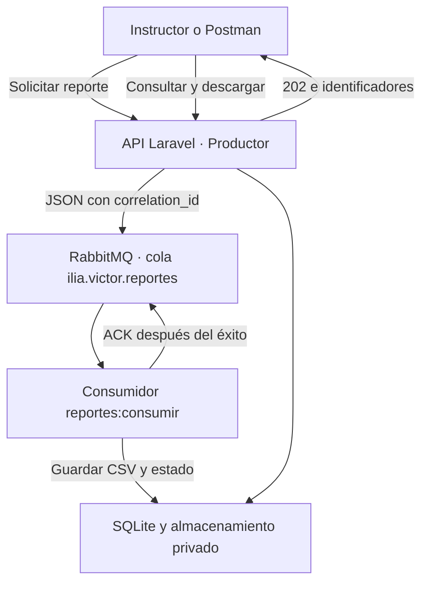

# Víctor Zambrano · Tema 3.1 · Reportes asíncronos de entregas

## Función incorporada

En **Mis tareas → abrir una tarea**, el instructor encuentra **Reportes de entregas**. El botón **Generar reporte** solicita un CSV en segundo plano. La pantalla consulta los estados cada cuatro segundos y habilita **Descargar CSV** cuando está disponible. Solo el instructor propietario de la tarea y solicitante del reporte puede consultar y descargarlo.

El CSV contiene una fila por entrega: identificador, estudiante, fecha UTC, número de versiones, eventos de pegado, mayor pegado y uso de IA declarado. No ejecuta ni califica el código. El reporte incluye las entregas cuyo identificador no supera el máximo registrado al solicitarlo: las posteriores requieren otro reporte. Los nombres y demás datos se leen cuando se genera el CSV; no se conserva una copia completa de las filas al solicitarlo.

## Instalar este paquete sobre el módulo existente

Extraer la carpeta `apps` del ZIP sobre la raíz de ILIA y aceptar el reemplazo de los archivos incluidos. Conserva los archivos anteriores de contratos y normalización. El paquete no contiene `.env`, credenciales, base SQLite, dependencias ni reportes personales. La migración tiene el mismo nombre ya creado durante la práctica: no la dupliques ni la renombres si ya fue ejecutada.

Requisitos adicionales: Docker Desktop activo, extensión PHP `sockets` habilitada y `php-amqplib/php-amqplib` 3.7 instalado. Desde `apps/entregas-codigo-victor`:

```powershell
composer require "php-amqplib/php-amqplib:~3.7.0"
php artisan config:clear
php artisan migrate
php artisan reportes:preparar-cola
php artisan test
```

Si ya instalaste la dependencia y ejecutaste la migración, no necesitas repetir el `composer require`. No uses `migrate:fresh` ni vuelvas a sembrar la base para instalar esta función.

Agrega a tu `.env` existente las variables de `reportes.env.example`, completando una contraseña de práctica propia. No sobrescribas el `.env`, su `APP_KEY` ni las contraseñas de los usuarios de ILIA. Laravel y Docker Compose deben usar las mismas credenciales de RabbitMQ. El archivo de ejemplo contiene únicamente nombres, parámetros locales y una contraseña vacía.

## Iniciar cada vez

Todos los comandos siguientes se ejecutan desde la carpeta del módulo, en terminales separadas:

**1. Broker:**

```powershell
docker compose --env-file .env -f compose.reportes.yml up -d --wait
docker compose --env-file .env -f compose.reportes.yml ps
```

Panel: http://localhost:15673. Usa `RABBITMQ_USER` y `RABBITMQ_PASSWORD`. Cola `ilia.victor.reportes`, en el vhost `ilia_victor`. Verificación por terminal, sin credenciales:

```powershell
docker compose --env-file .env -f compose.reportes.yml exec rabbitmq rabbitmqctl list_queues -p ilia_victor name messages_ready messages_unacknowledged consumers
```

**2. API Laravel:**

```powershell
php artisan serve --host=localhost --port=8010
```

**3. Consumidor:**

```powershell
php artisan reportes:consumir
```

Deja la terminal abierta. Este consumidor es un comando propio que consume JSON AMQP: **no se sustituye por `php artisan queue:work`**. Para detenerlo usa Ctrl+C en su terminal. Para procesar un solo mensaje y salir: `php artisan reportes:consumir --once` (esperará si la cola está vacía).

**4. Acceso desde ILIA:** inicia Expo desde `apps/mobile`, con `EXPO_PUBLIC_CODE_MODULE_URL=http://localhost:8010` en su `.env.local`, siguiendo el README del módulo. Entra como instructor y abre la tarea. RabbitMQ y el consumidor deben estar activos para finalizar reportes. Si el consumidor está detenido, el botón puede aceptar solicitudes que permanecerán pendientes.

## Rutas y contrato de entrada

Todas las rutas requieren sesión del módulo y rol instructor. Las operaciones POST también requieren CSRF. En Postman utiliza `Accept: application/json`, `Content-Type: application/json`, las cookies de sesión y `X-CSRF-TOKEN`.

| Método | Ruta | Función |
|---|---|---|
| POST | `/api/practica/reportes-entregas` | Publicar solicitud. Devuelve 202 tras confirmación del broker. |
| POST | `/api/practica/reportes-entregas/sincrono` | Generar el mismo CSV antes de responder. Devuelve 201 al finalizar. |
| GET | `/api/practica/tareas/1/reportes` | Listar los últimos 20 reportes propios de una tarea. |
| GET | `/api/practica/reportes-entregas/{uuid}` | Consultar estado, fechas e identificadores. |
| GET | `/reportes-entregas/{uuid}/descargar` | Descargar un CSV completado mediante una ruta autorizada. |

Cuerpo para ambas rutas POST:

```json
{"exercise_id": 1}
```

El identificador debe ser un entero JSON de una tarea propia. Si se omite o tiene un tipo incorrecto, responde 422; si la tarea es ajena o inexistente, 404. Un estudiante recibe 403. Un cliente sin sesión que solicita JSON recibe 401; si el POST carece de CSRF puede intervenir antes un 419.

Encabezado opcional `X-Correlation-ID`: UUID válido. Si se omite, el servidor genera uno. Lo devuelve en encabezado y cuerpo, y lo conserva en el mensaje y los registros de procesamiento. Cada solicitud nueva crea un `message_id` y un reporte nuevos, aunque conserve el mismo correlation ID. Este encabezado no es un token de acceso ni una clave de idempotencia.

Una respuesta 202 incluye `data.id`, `message_id`, `correlation_id`, `status`, `status_url` y, solo si ya terminó, `download_url`. El consumidor puede terminar antes de que el cliente reciba la respuesta: 202 significa recepción aceptada, no una garantía de que el trabajo siga pendiente.

## Mensaje AMQP

Ejemplo ficticio, generado por el productor:

```json
{
  "message_id": "b87bdf77-6379-4729-9887-de8999b1231d",
  "correlation_id": "6fae840e-a5c9-4fde-9906-8152fafb4954",
  "tipo": "reporte_entregas.solicitado",
  "ocurrido_en": "2026-11-21T03:30:00.000000Z",
  "payload": {
    "reporte_id": "e7e693a4-ed79-4841-a968-4203f787d949",
    "tarea_id": 1
  }
}
```

El mensaje no incluye contraseñas, cookies, nombres de estudiantes ni el código enviado. `message_id` identifica el mensaje; `correlation_id` relaciona las etapas de la operación. El consumidor valida los campos y comprueba que coincidan con el reporte registrado.



## Estados, confirmaciones y errores

- `pending`: solicitud registrada y en espera de procesamiento.
- `processing`: un procesador tomó el trabajo y aumentó el contador de intentos.
- `completed`: CSV guardado, cantidad de filas y fecha final registradas. La interfaz muestra **Disponible**.
- `failed`: fallo de generación o publicación no confirmada. El mensaje público es genérico.

La cola es duradera, los mensajes son persistentes y el productor utiliza publicación obligatoria y publisher confirms. Si el broker no confirma, la API devuelve 503 y un identificador para consultar. Una desconexión puede impedir recibir la confirmación aunque RabbitMQ haya recibido el mensaje: comprueba el estado antes de repetir; no existe un outbox ni una republicación automática en esta versión.

El consumidor utiliza confirmación manual y prefetch 1. Envía ACK solo después de guardar el CSV y el estado completed. Una reentrega de un reporte ya completado se confirma sin volver a generarlo. Ante un error de generación, registra failed y reencola hasta un máximo de tres intentos. Al agotarlos rechaza sin reencolar: **el mensaje se retira del broker, el reporte fallido permanece en SQLite y esta práctica no configura una cola de mensajes fallidos**. Se puede solicitar un reporte nuevo después de corregir la causa. Un mensaje malformado o incoherente también se rechaza sin reencolar.

Si el proceso termina bruscamente, RabbitMQ reentrega los mensajes sin ACK, pero la tabla puede conservar processing. Con **todos los demás consumidores de esta práctica detenidos**, puedes recuperar los interrumpidos:

```powershell
php artisan reportes:consumir --recuperar-interrumpidos
```

Esta recuperación es manual y no debe ejecutarse junto con otro consumidor activo. Si se detecta un trabajo ya processing, el consumidor conserva el mensaje y se detiene para evitar generar dos archivos simultáneamente.

Los registros de `storage/logs/laravel.log` incluyen `reporte.recibido`, `reporte.publicado`, `reporte.procesando`, `reporte.completado` o `reporte.fallido`, con identificadores y estados. No se registra el cuerpo de solicitudes, el mensaje completo ni detalles de conexión. Los CSV se guardan bajo `storage/app/private/reportes-entregas`, nunca bajo public. La descarga comprueba sesión, rol, solicitante y propiedad actual de la tarea.

## Pruebas de la guía con RabbitMQ real

1. Inicia sesión como instructor en Postman: GET `/acceso/csrf`, POST `/acceso/login` con el token y las cookies; después vuelve a obtener CSRF. No captures contraseñas, tokens ni cookies.
2. **Mensaje válido:** envía al menos tres POST válidos a la ruta asíncrona; anota los tres report IDs y correlation IDs. Comprueba 202, generación del consumidor, estado completed y CSV descargable. Registra capturas de petición, cola y resultado. La interfaz también permite solicitar reportes, pero la guía pide tres mensajes desde Postman.
3. **Consumidor detenido:** detén únicamente `reportes:consumir`, conserva RabbitMQ y la API activos, solicita otro reporte y comprueba 202, pending y `messages_ready > 0`. Reinicia el consumidor y verifica completed y que se vacía la cola. No uses Purge/Delete/Get messages en el panel durante esta evidencia.
4. **Mensaje inválido:** envía `{}` al POST, con sesión y CSRF válidos. Debe responder 422 con `errors.exercise_id` y no crear un reporte ni publicar un mensaje.
5. **Correlación:** consulta el reporte y busca su mismo correlation ID en los registros de productor y consumidor. El detalle **Seguimiento del reporte** en la pantalla muestra los identificadores.
6. **Comparación:** con las mismas entregas y sin agregar otras entre ejecuciones, solicita un CSV síncrono y uno asíncrono. Registra el tiempo de Postman, created_at, started_at y completed_at. Descarga ambos y compara sus filas. No hay esperas artificiales: con pocas entregas las diferencias pueden ser pequeñas y AMQP puede añadir más tiempo inicial; explica el resultado medido.

| Aspecto | Síncrono | Asíncrono |
|---|---|---|
| Respuesta inicial | 201 después de generar el CSV; anotar tiempo medido | 202 después de publicar; anotar tiempo medido |
| Finalización | Antes de la respuesta | Consultar completed_at; puede ocurrir antes o después de recibir 202 |
| Consumidor detenido | No depende del consumidor ni de RabbitMQ | Acepta con broker activo y permanece pendiente |
| Broker detenido | Puede generar el CSV | Responde 503 si no confirma publicación |
| Trazabilidad | Report ID, correlation ID y fechas | Los mismos identificadores en API, mensaje y consumidor |

Documento de entrega: código e instrucciones; diagrama; capturas de las cuatro pruebas; tabla con mediciones reales y documento breve de máximo dos páginas adicionales que explique el proceso, resultados y una dificultad real con su solución.

## Validación incluida

`tests/Feature/ReporteEntregasTest.php` verifica solicitudes válidas e inválidas, roles y propiedad, fallos públicos sin secretos, equivalencia de CSV síncrono/asíncrono, exclusión de entregas posteriores, tarea sin entregas, protección de descarga, nombres que podrían interpretarse como fórmulas, idempotencia del procesamiento, confirmación y reencolado. Las pruebas de AMQP utilizan dobles de transporte: no sustituyen las evidencias con RabbitMQ real indicadas arriba.
