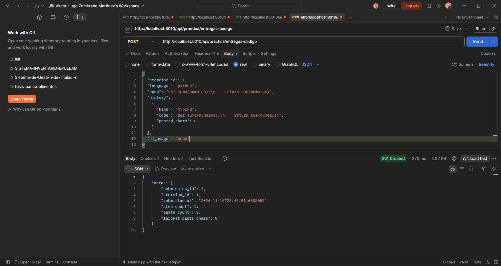
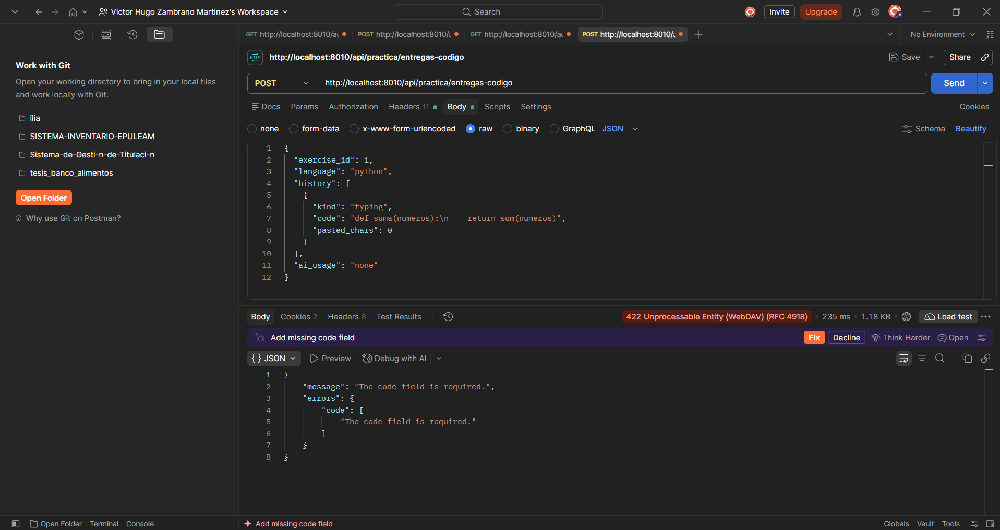
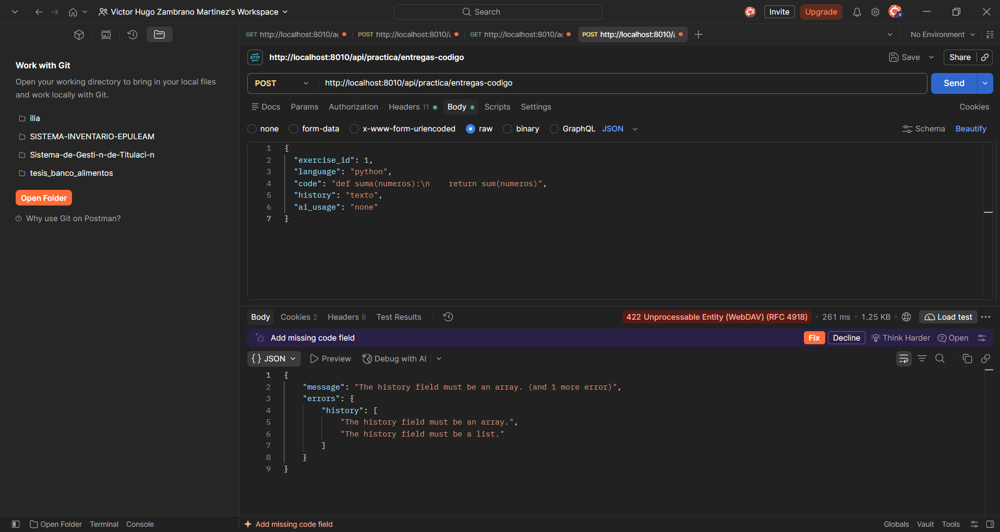
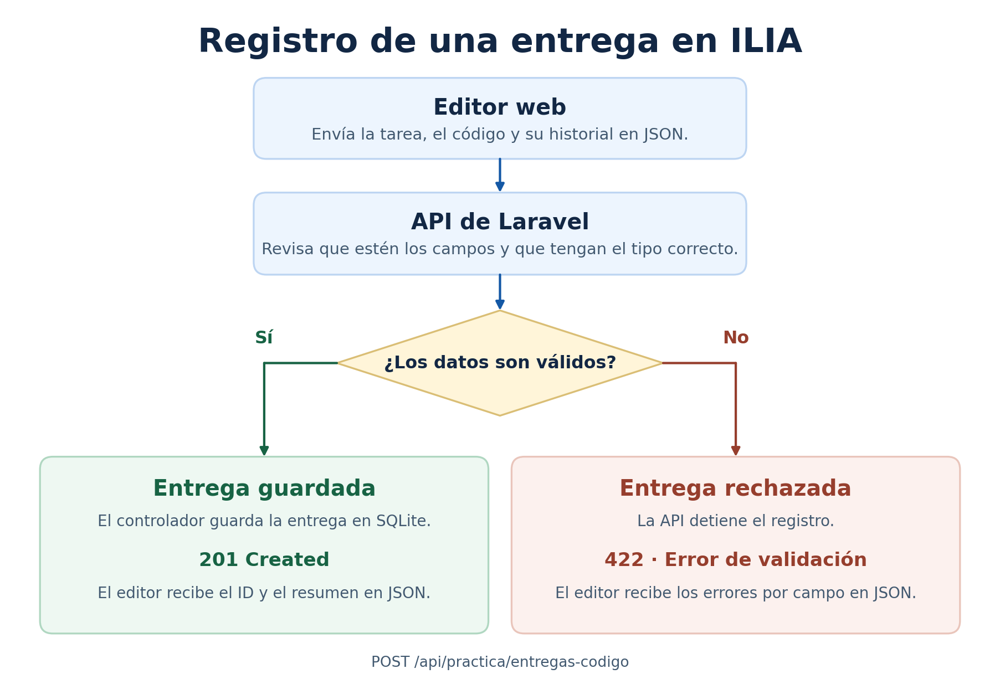

## Cómo ejecutar el módulo en Windows

### Requisitos

- **PHP 8.2 o superior.** Si aún no tienes PHP, puedes instalar [XAMPP para Windows con PHP 8.2](https://www.apachefriends.org/es/download.html). Agrega al `Path` de Windows la carpeta que contiene `php.exe`, por ejemplo `C:\xampp\php`.

- **Composer 2.** Ejecuta [Composer-Setup.exe](https://getcomposer.org/Composer-Setup.exe) y selecciona el `php.exe` de tu instalación cuando te lo pida.

- **Node.js y npm.** Instala [Node.js LTS para Windows](https://nodejs.org/en/download). El instalador incluye npm.

Después de instalar, cierra y vuelve a abrir VS Code. Comprueba las versiones y las extensiones de PHP desde PowerShell:

```powershell
php -v
composer --version
node -v
npm -v
php -m | Select-String '^(pdo_sqlite|mbstring|openssl)$'
```

El último comando debe listar `pdo_sqlite`, `mbstring` y `openssl`. Si falta alguna extensión, usa `php --ini` para localizar el archivo `php.ini` activo y habilítala.

### 1. Configuración inicial

#### Laravel

Desde la raíz de ILIA, abre una terminal PowerShell y ejecuta:

```powershell
cd apps/entregas-codigo-victor
composer install

if (-not (Test-Path .env)) {
    Copy-Item .env.example .env
    php artisan key:generate
}

if (-not (Test-Path database/database.sqlite)) {
    New-Item database/database.sqlite -ItemType File
}
```

Abre `apps/entregas-codigo-victor/.env` y asigna una contraseña de prueba distinta a cada cuenta. Usa contraseñas de 12 a 64 bytes.

| Variable en `.env` | Cuenta de prueba |
|---|---|
| `PRACTICA_STUDENT_PASSWORD` | `student@practica.test` |
| `PRACTICA_INSTRUCTOR_PASSWORD` | `instructor@practica.test` |

Guarda el archivo y ejecuta el siguiente comando desde la carpeta del módulo. Esto crea las tablas y prepara las cuentas y la tarea de ejemplo **Suma de una lista**.

```powershell
php artisan migrate --seed
```

#### Interfaz web de ILIA

Abre una segunda terminal PowerShell desde la raíz de ILIA e instala las dependencias de la interfaz:

```powershell
cd apps/mobile
npm ci
```

En `apps/mobile`, crea el archivo `.env.local` o ábrelo si ya existe. Agrega esta línea y guarda el archivo:

```dotenv
EXPO_PUBLIC_CODE_MODULE_URL=http://localhost:8010
```

Esta configuración se hace una sola vez. Expo carga la URL al iniciar y con ella habilita el botón **Entrar al módulo de código**.

### 2. Iniciar el módulo cada vez que lo uses

Abre dos terminales PowerShell desde la raíz de ILIA.

**Terminal 1 · Laravel**

```powershell
cd apps/entregas-codigo-victor
php artisan serve --host=localhost --port=8010
```

**Terminal 2 · Interfaz web**

```powershell
cd apps/mobile
npm run web -- --port 8081
```

Deja ambas terminales abiertas. Abre [http://localhost:8081/login](http://localhost:8081/login), pulsa **Entrar al módulo de código** e inicia sesión con la cuenta de estudiante o instructor.

Para volver a usar el módulo, basta con los comandos de la sección **Iniciar el módulo cada vez que lo uses**. Conserva el `.env` de Laravel, el `.env.local` de Expo y la base de datos SQLite.

## Actividad 1. Selección del proceso

Para esta práctica seleccioné el módulo **registro de una entrega de código** de la plataforma de ILIA, elegí este proceso porque permite ver cómo el editor web envía la solución del estudiante a Laravel y cómo el servidor confirma que la entrega quedó guardada.

### Actores

- **Estudiante.** Abre una tarea, escribe su solución en el editor y envía el código final junto con el historial de edición y su declaración sobre el uso de IA.

- **Instructor.** Abre la tarea desde su panel, consulta las entregas recibidas y revisa el historial de cada solución paso a paso.

### Intercambio de información

El editor envía la entrega al endpoint usado: `POST /api/practica/entregas-codigo`. La solicitud contiene el identificador de la tarea, el lenguaje de programación, el código final, el historial de edición y la declaración de uso de IA.

Laravel valida los datos y guarda la entrega, si el registro se completa, responde con `201 Created` y devuelve el identificador de la entrega, el identificador de la tarea, la fecha de envío y un resumen del historial con el número de pasos, la cantidad de pegados y el tamaño del pegado mayor registrado.

## Actividad 2. Diseño de los contratos JSON
En esta actividad definí dos contratos JSON para el registro de entregas de código en ILIA. 
Un contrato JSON especifica qué campos intercambian el cliente y el servidor, qué tipo de dato tiene cada uno, si es obligatorio y qué significa.

El **contrato de solicitud** describe los datos que el editor web envía a Laravel, como el código final y el historial de edición. 

### Contrato de solicitud

| Campo | Tipo JSON | ¿Obligatorio? | Significado |
|---|---|---|---|
| `exercise_id` | Entero | Sí | Identificador de una tarea existente. |
| `language` | Cadena | Sí | Lenguaje de programación de la tarea. Admite `python`, `javascript` o `php` y debe coincidir con el lenguaje configurado en la tarea. |
| `code` | Cadena | Sí | Código final de la solución. Admite hasta 10 000 caracteres y conserva la sangría y los saltos de línea. |
| `history` | Arreglo de objetos | Sí | Historial de 1 a 100 pasos, ordenados desde la primera edición hasta la última. El código del último paso debe coincidir con `code`. |
| `history[].kind` | Cadena | Sí | Tipo de cambio del paso. `typing` indica una edición y `paste` indica un pegado. |
| `history[].code` | Cadena | Sí | Código completo al terminar el paso. Admite hasta 10 000 caracteres y puede estar vacío si el estudiante borró todo. |
| `history[].pasted_chars` | Entero | Sí | Cantidad de caracteres pegados en el paso. Es `0` para `typing` y de `1` a `10000` para `paste`. |
| `ai_usage` | Cadena | Sí | Uso de IA declarado por el estudiante. Admite `none` (sin uso), `consultation` (consulta) o `generation` (generación). |

El **contrato de respuesta** describe los datos que Laravel devuelve después de guardar la entrega, como su identificador y el resumen del historial. Así, el editor y el servidor interpretan los datos de la misma manera.

### Contrato de respuesta exitosa (`201 Created`)

| Campo | Tipo JSON | ¿Siempre presente? | Significado |
|---|---|---|---|
| `data` | Objeto | Sí | Contiene los datos de la entrega registrada. |
| `data.submission_id` | Entero | Sí | Identificador de la entrega generado por el servidor. |
| `data.exercise_id` | Entero | Sí | Identificador de la tarea a la que pertenece la entrega. |
| `data.submitted_at` | Cadena | Sí | Fecha y hora del registro en UTC, en formato ISO 8601. |
| `data.step_count` | Entero | Sí | Cantidad total de pasos guardados en el historial. |
| `data.paste_count` | Entero | Sí | Cantidad de pasos registrados como pegado. |
| `data.largest_paste_chars` | Entero | Sí | Cantidad de caracteres del mayor pegado registrado. Es `0` si no hubo pegados. |

## Actividad 3. Implementación del intercambio en Laravel

Implementé el endpoint `POST /api/practica/entregas-codigo` para recibir y guardar las entregas de código enviadas desde el editor web de ILIA.

1. **Deserialización.** Laravel lee el cuerpo JSON de la solicitud y lo convierte en datos que puede procesar.
2. **Validación.** `StoreCodeSubmission` comprueba los campos obligatorios y sus tipos, también verifica que la tarea exista y que el código del último paso del historial coincida con el código final.
3. **Registro.** Con los datos validados, el controlador construye el DTO `CodeSubmission` y guarda la entrega y su historial en SQLite.
4. **Serialización.** El controlador usa `response()->json()` para convertir los datos de la entrega y el resumen del historial en una respuesta JSON que el cliente puede leer.

- Cuando la entrega se guarda correctamente, la API responde con `201 Created`. 
- Si algún campo incumple el contrato, Laravel devuelve `422` con el detalle del error en `errors` y la entrega no se guarda.

## Actividad 4. Comprobación del contrato JSON

Probé en Postman el endpoint `POST /api/practica/entregas-codigo` con la cuenta de estudiante, y envié una entrega válida y dos solicitudes con errores para verificar las reglas del contrato.

### P1. Entrega válida

Envié todos los campos obligatorios con los tipos esperados. La API respondió con `201 Created` y devolvió el identificador `3`, lo que confirmó el registro de la entrega.



*Figura 1. Solicitud válida y respuesta `201 Created` con el identificador de la entrega.*

### P2. Campo obligatorio faltante

Eliminé el campo `code` del nivel principal de la solicitud y conservé el código de cada paso dentro de `history`. La API respondió con `422` e indicó en `errors.code` que el campo era obligatorio.



*Figura 2. Respuesta `422` por la ausencia del campo obligatorio `code`.*

### P3. Tipo de dato incorrecto

Volví a incluir `code` y envié `history` como texto (`"texto"`). La API respondió con `422` e indicó en `errors.history` que el campo debía ser un arreglo.



*Figura 3. Respuesta `422` porque `history` recibió una cadena de texto.*

### Verificación en el panel del instructor

Abrí la tarea **Suma de una lista** desde el panel del instructor y comprobé que la entrega `#3` coincidía con el identificador devuelto en P1. De los tres intentos, solo el válido generó una entrega.


*Figura 4. La entrega `#3` aparece en la lista de entregas recibidas.*

### Interpretación de los datos

El contrato establece que `history` contiene los pasos en el orden en que ocurrieron, el panel del instructor utiliza ese orden para recorrer las versiones del código y también aclara que `paste_count` cuenta los pegados registrados por el editor y que `ai_usage` contiene la declaración del estudiante sobre su uso de IA.

## Diagrama del intercambio de datos



*Figura. El editor envía la entrega en JSON y Laravel devuelve `201` si la guarda o `422` si falla la validación.*